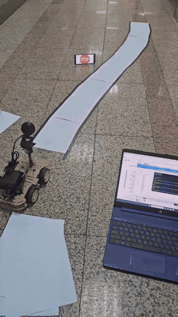
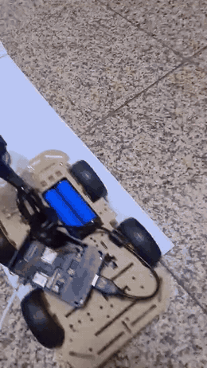
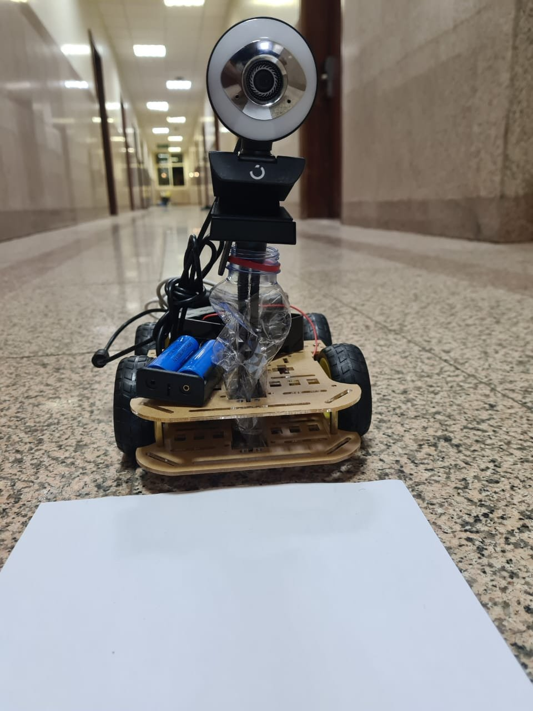
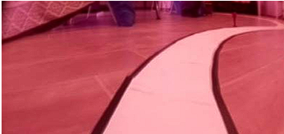
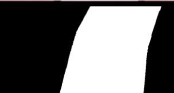
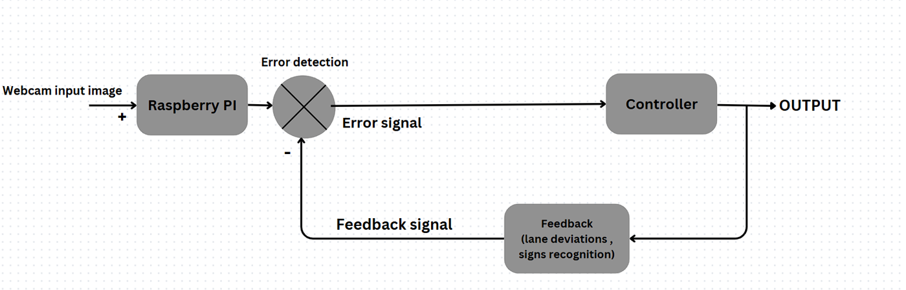
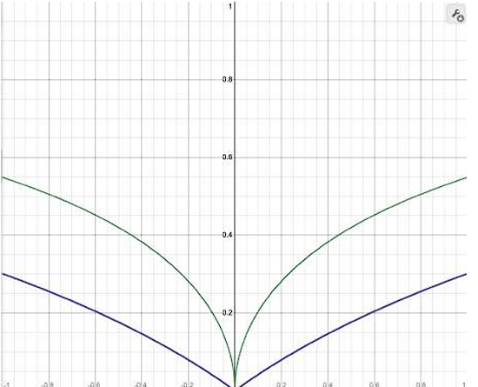
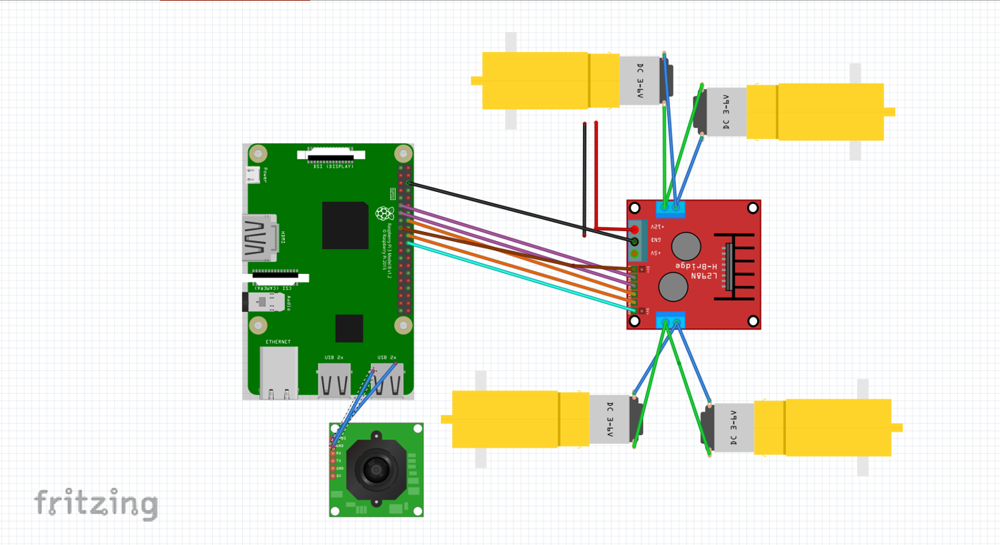

# Self-Driving Car Prototype (Raspberry Pi + OpenCV)

> Control Theory (EE 3631) design project · team project · I was team leader

A low-cost, modular **lane-following car**. A Raspberry Pi 3 reads a webcam, finds the lane with classic image processing (perspective warp, thresholding and edge detection) and steers the motors with PWM in a closed feedback loop. It also stops at a **STOP sign** detected with a Haar-cascade classifier.

## Demo

| Lane following (processed view on the laptop) | Stopping at the STOP sign |
|---|---|
|  |  |

Full-length videos: [`media/testing_2.mp4`](media/testing_2.mp4) · [`media/testing_1.mp4`](media/testing_1.mp4)

<p align="center"></p>

## How it works

### Vision pipeline
| Camera view | Bird's-eye threshold | Lane mask |
|---|---|---|
|  |  |  |

1. Capture frames at reduced resolution (240×480) so the Pi 3 keeps up in real time.
2. Warp the perspective to a bird's-eye view and threshold the image to isolate the lane.
3. Take the lane centre as the mean column of the lane pixels. The error is its distance from the image centre (pixel 240).
4. A Haar-cascade classifier watches for STOP signs.

### Control law
<p align="center"></p>

The pixel error is normalised by 240, so x is between -1 and 1, and mapped to motor power with a **log / square-root shaped function**. This keeps the duty cycle between **10 % and 60 %**: below 10 % the motors stall, and above 60 % the car becomes unstable. Small errors give almost no correction, which prevents zig-zagging. Larger errors give progressively stronger steering, which is applied differentially to the left and right motors through the L298N.

<p align="center"></p>

### Hardware
| Component | Role |
|---|---|
| Raspberry Pi 3 | Image processing and control |
| USB webcam | Road camera |
| L298N H-bridge | Motor driver (PWM speed and direction) |
| 4 × DC gear motors + chassis | Drive train |
| Battery pack + power bank | Separate motor and Pi supplies |

<p align="center"></p>

The editable wiring is in [`hardware/self_driving_car_schematic.fzz`](hardware/self_driving_car_schematic.fzz) (Fritzing). The system architecture is shown in [`docs/architecture.png`](docs/architecture.png).

## Results (from the project report)
- **85 %** of the time in the lane under good conditions, and about 70 % in low light or with poor lane markings
- About **0.5 s** steering correction time, and under 1 s in tight curves
- Smooth motion with no oscillation, thanks to the shaped control function

## Repository contents
| Path | |
|---|---|
| `media/` | Demo GIFs, test videos and photos of the car |
| `docs/` | Diagrams and figures from the report |
| `hardware/` | Fritzing schematic |
| `src/util.py` | `get_limit()`, which gives HSV bounds for colour-based detection |
| `src/main.py` + `models/` | MediaPipe face-detection experiment, the first step of a face-blur feature |

> The car's original driving script is not included in this repository. `src/` holds the vision helpers developed alongside it.

```bash
pip install -r requirements.txt
python src/main.py path/to/image.jpg
```

## Future work
A PID steering controller, adaptive thresholding or a CNN for lane detection, and more traffic-sign classes.
